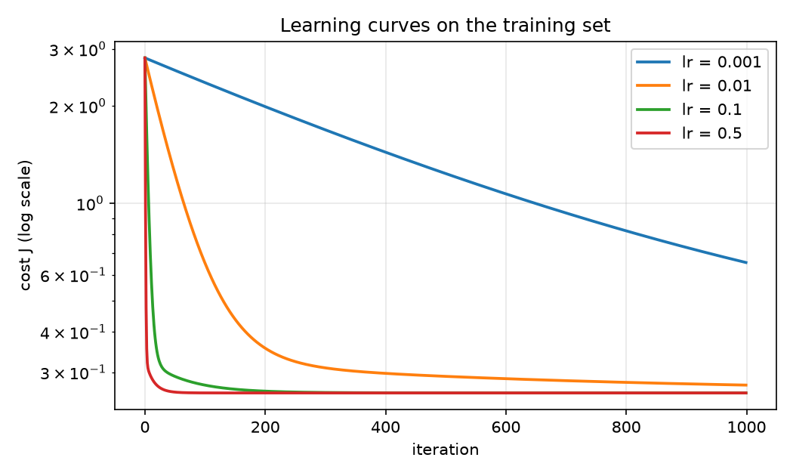
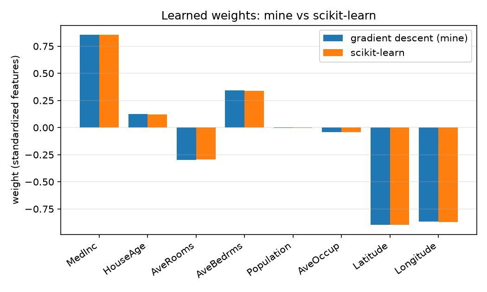
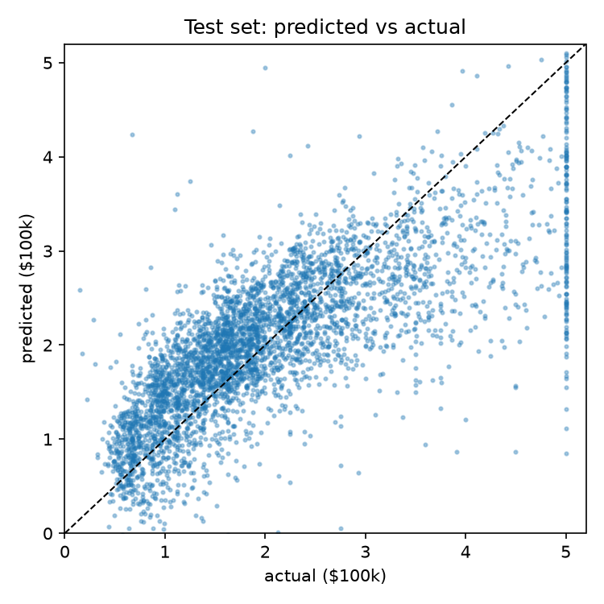

# 01 · Linear Regression from scratch

Linear regression implemented with NumPy only (z-score scaling + vectorized batch gradient descent), trained on California Housing and checked against scikit-learn.

## Problem

Predict the median house value of a California district (in $100k) from 8 features: median income, house age, average rooms, average bedrooms, population, average occupancy, latitude, longitude. 20,640 samples.

## Method

- **Split:** 80/20 train/test, `random_state=42`.
- **Scaling:** z-score, with mean and std computed on the train set only, then applied to both sets (no leakage).
- **Model:** `ŷ = Xw + b`
- **Cost:** `J(w, b) = 1/(2m) · Σ (ŷ − y)²`
- **Optimizer:** batch gradient descent, fully vectorized:
  `w ← w − α · Xᵀ(ŷ − y) / m`, `b ← b − α · mean(ŷ − y)`
- **Correctness check:** weights and test RMSE compared against `sklearn.linear_model.LinearRegression`.

## Results

<!-- Run `python src/run_experiment.py`, then paste results/results.md here. -->







Raw numbers: [`results/metrics.json`](results/metrics.json)

## What I learned

<!-- Write 4-5 lines in your own words: what the learning-rate sweep showed (too small / good / diverging), why scaling matters for gradient descent, how close you got to sklearn, and where a linear model fails on this data. -->

## Reproduce

```bash
pip install -r ../requirements.txt
python src/run_experiment.py     # downloads the dataset via scikit-learn, writes results/
python -m pytest tests           # unit tests
```

The dataset is fetched by scikit-learn on first run and is not stored in the repo.

## Files

| Path | Purpose |
|---|---|
| `src/linear_regression.py` | `StandardScaler`, `LinearRegressionGD`, `rmse`, `r2_score` |
| `src/run_experiment.py` | Training, learning-rate sweep, sklearn comparison, plots |
| `tests/` | Scaler behaviour, monotonic cost, match with sklearn, divergence at a huge learning rate |
| `notebooks/` | Exploration notebooks |
| `results/` | Plots and metrics |
